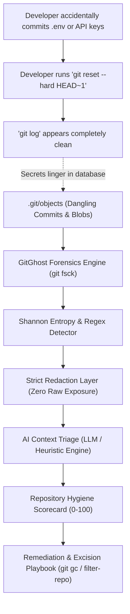

<div align="center">

```
   ██████╗ ██╗████████╗ ██████╗ ██╗  ██╗ ██████╗ ███████╗████████╗
  ██╔════╝ ██║╚══██╔══╝██╔════╝ ██║  ██║██╔═══██╗██╔════╝╚══██╔══╝
  ██║  ███╗██║   ██║   ██║  ███╗███████║██║   ██║███████╗   ██║   
  ██║   ██║██║   ██║   ██║   ██║██╔══██║██║   ██║╚════██║   ██║   
  ╚██████╔╝██║   ██║   ╚██████╔╝██║  ██║╚██████╔╝███████║   ██║   
   ╚═════╝ ╚═╝   ╚═╝    ╚═════╝ ╚═╝  ╚═╝ ╚═════╝ ╚══════╝   ╚═╝   
```

# 👻 GitGhost

### **Enterprise Git Object Forensics, Dangling Secret Hunter & Excision Playbook**

*Unearthing what `git reset --hard` left behind in your `.git` graveyard.*

[](https://github.com/your-username/gitghost/actions)
[](https://pypi.org/project/gitghost/)
[](https://opensource.org/licenses/MIT)
[](https://sarifweb.azurewebsites.net/)
[](#-interactive-desktop--web-uiux)
[](https://github.com/your-username/gitghost/pulls)

</div>

---

## 🪝 The Hook: Why GitGhost?

Developers frequently believe that running commands like:
```bash
git reset --hard HEAD~1
git rebase -i
git branch -D feature/leaked-credentials
```
permanently removes committed secrets or private configurations from their repository.

**In reality, Git does NOT delete them.**

Git preserves these objects as **Dangling Commits** and **Unreachable Blobs** inside the local object store (`.git/objects/`). They remain quietly on disk, accessible through object hashes, surviving in developer workstations, CI/CD caches, and backup snapshots.

**GitGhost** is a specialized forensics and security engineering tool for local repositories and CI/CD pipelines. It exhuming orphaned objects, calculates Shannon entropy, strictly redacts credentials, performs AI context triage, grades repository hygiene, and provides targeted remediation recipes.

---

## 📊 How It Works: The Ghost Object Lifecycle



---

## ✨ Core Features

- **🔍 Live Object-Store Forensics (`git_forensics.py`)**:
  - Traverses `.git/objects` using `git fsck --full --no-reflogs --unreachable --lost-found`.
  - Exhumes unreachable commits, trees, and blobs that are disconnected from active refs (`HEAD`, branches, tags).
  - Reconstructs complete metadata: author, timestamp, commit subject, changed files, and unified diffs.

- **🛡️ Strict Secret Redaction (`redactor.py`)**:
  - Computes Shannon entropy on orphaned diffs to detect high-entropy keys, passwords, and random tokens.
  - Multi-pattern detection for AWS credentials, GitHub/GitLab tokens, Slack webhooks, Private Keys, Database URIs, and `.env` configs.
  - **Zero Leak Guarantee**: All discovered credentials are cryptographically masked (`AKIA************MPLE`, `[REDACTED_DB_PASSWORD]`) before terminal rendering, report export, or AI prompt dispatch.

- **🤖 AI-Powered Context Triage (`ai_triage.py`)**:
  - Analyzes commit messages, author intent, surrounding code syntax, and file paths.
  - Distinguishes real active leaks from false positives (e.g., test fixtures, documentation samples, mock keys).
  - Multi-provider support: Google Gemini, OpenAI GPT-4o, Anthropic Claude, local Ollama, or built-in offline Heuristics.

- **📈 Repo Hygiene Scorecard (`scoring.py`)**:
  - Computes a comprehensive 0–100 repository hygiene grade.
  - Itemized deduction breakdown penalizing critical credentials, dangling object accumulation, and active threat recency.

- **🛠️ Automated Excision Recipes (`remediation.py`)**:
  - Customized `git filter-repo` commands to rewrite offending tree paths.
  - Physical disk excision scripts: `git reflog expire --expire=now --all` and `git gc --prune=now --aggressive`.

- **📋 CI/CD Gatekeeper & Exporters (`exporters.py`)**:
  - Exports standard **SARIF 2.1.0** reports for direct ingestion into GitHub Security Code Scanning and SonarQube.
  - Exports structured JSON and formatted Markdown audit reports.
  - `gitghost install-hook`: Installs a `pre-push` protection hook into `.git/hooks/`.

---

## 🖥️ Interactive Desktop & Web UI/UX

GitGhost comes equipped with a modern, dark-mode cybersecurity dashboard:

```bash
# Launch native desktop application (Edge WebView2 / PySide6)
gitghost ui

# Or launch in your default web browser
gitghost ui --web

# Specify custom port or target repository
gitghost ui /path/to/repo --port 8765
```

### Dashboard Highlights:
- **Circular Hygiene Gauge**: Real-time animated SVG gauge showing grade (A+, A, B, C, D, F) and score.
- **Secrets Inspector**: Interactive table with severity filters, Shannon entropy values, and AI triage verdicts. Clicking any finding displays the redacted context line and commit metadata.
- **Graveyard Explorer**: Visual explorer of all dangling commits, author details, dates, and unreachable blobs.
- **One-Click Remediation**: Copy customized `git filter-repo` and `git gc` commands, or safely execute cleanup directly from the UI.
- **One-Click Exports**: Instant export to SARIF 2.1.0, Markdown, JSON, and pre-push hook installation.

---

## 🚀 Quickstart & CLI Usage

### ⚡ 5-Second Instant Sandbox Demo

Test GitGhost in 5 seconds without touching any real repositories:

```bash
gitghost demo
```

> **What it does:** Automatically creates an isolated temporary Git sandbox, simulates a developer accidentally committing a `.env` file with live credentials and running `git reset --hard HEAD~1`, runs the full forensics pipeline to unearth the ghost commit, and cleanly disposes of the sandbox.

### Installation

```bash
# Clone repository
git clone https://github.com/your-username/gitghost.git
cd gitghost

# Install dependencies and package
pip install -e .

# Or with desktop UI support:
pip install -e ".[desktop]"
```

### Live Forensics Scan

```bash
# Audit current repository with offline heuristic triage
gitghost scan .

# Audit with Google Gemini or OpenAI AI triage
export GEMINI_API_KEY="your-gemini-key"
gitghost scan /path/to/repo -p gemini

# CI/CD mode: fail pipeline if hygiene score < 70 or critical leaks exist
gitghost scan . --strict --format sarif --output audit_report.sarif
```

### Install Pre-Push Protection Hook

```bash
gitghost install-hook .
```

### Safe History Excision (Purge Unreferenced Objects)

```bash
# Preview cleanup commands
gitghost clean --dry-run

# Execute physical purge
gitghost clean
```

---

## 🔒 Security & Privacy Guarantee

1. **Authorized Local Scans Only**: GitGhost operates strictly on local repository paths provided by the user.
2. **Never Sends Raw Secrets to AI**: The redaction engine operates **prior** to AI prompt construction. LLMs only ever observe masked placeholders (e.g. `AKIA************MPLE`), guaranteeing zero credentials leak outside your machine.
3. **Offline by Default**: Works 100% offline using the built-in Heuristic Rule-Engine without requiring any external network access or cloud API keys.

---

## 📄 License

MIT License. See [LICENSE](LICENSE) for full details.
