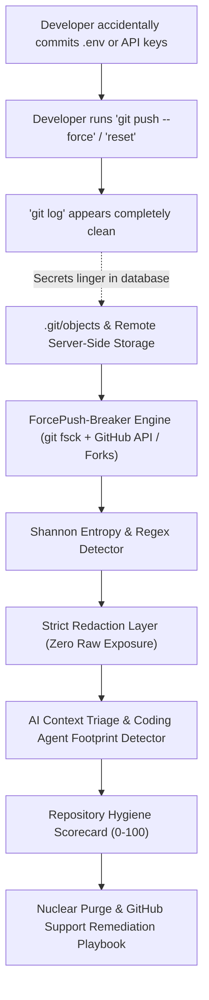

<div align="center">

```
 ███████╗ ██████╗ ██████╗  ██████╗███████╗██████╗ ██╗   ██╗███████╗██╗  ██╗
 ██╔════╝██╔═══██╗██╔══██╗██╔════╝██╔════╝██╔══██╗██║   ██║██╔════╝██║  ██║
 █████╗  ██║   ██║██████╔╝██║     █████╗  ██████╔╝██║   ██║███████╗███████║
 ██╔══╝  ██║   ██║██╔══██╗██║     ██╔══╝  ██╔═══╝ ██║   ██║╚════██║██╔══██║
 ██║     ╚██████╔╝██║  ██║╚██████╗███████╗██║     ╚██████╔╝███████║██║  ██║
 ╚═╝      ╚═════╝ ╚═╝  ╚═╝ ╚═════╝╚══════╝╚═╝      ╚═════╝ ╚══════╝╚═╝  ╚═╝
```

# ForcePush-Breaker (UnForce)

### **Audit and recover hidden secrets from overwritten GitHub history.**

*"Think `git push --force` deleted your leaked API keys? Think again."*

[](https://github.com/your-username/forcepush-breaker/actions)
[](https://pypi.org/project/unforce/)
[](https://opensource.org/licenses/MIT)
[](https://sarifweb.azurewebsites.net/)
[](#interactive-desktop--web-uiux)
[](https://github.com/your-username/forcepush-breaker/pulls)

</div>

---

## The Problem: Why ForcePush-Breaker?

Developers frequently believe that running commands like:
```bash
git reset --hard HEAD~1
git push origin --force
git rebase -i
git branch -D feature/leaked-credentials
```
permanently removes committed secrets or private configurations from their repository.

**In reality, Git does NOT delete them.**

Git preserves these objects as **Dangling Commits** and **Unreachable Blobs** inside the local object store (`.git/objects/`) and GitHub's internal caches. They remain quietly accessible through object hashes, surviving in developer workstations, forks, CI/CD caches, and backup snapshots.

**ForcePush-Breaker (UnForce)** is a specialized forensics and security engineering tool for local repositories and GitHub remotes. It exhuming orphaned objects, calculates Shannon entropy, strictly redacts credentials, performs AI context triage, grades repository hygiene, and provides targeted remediation recipes.

---

## Architecture & Forensics Pipeline



---

## Core Capabilities

- **Remote GitHub Forensics & Smart Mirror Cloner (`github_remote.py`)**:
  - Accepts remote GitHub URLs (`https://github.com/owner/repo`, `git@github.com:owner/repo.git`, or `owner/repo`) directly in the UI and CLI.
  - Queries the GitHub REST API (`/events`, `/pulls?state=closed`, `/commits/{sha}`, `/forks`) to detect **Force-Push overwrites**, deleted branch refs, and unmerged PR commits (`before` SHAs).
  - Performs a smart `--mirror` clone (`+refs/pull/*:refs/pull/*`), explicitly fetches orphaned commit SHAs from GitHub's object store, and guarantees automatic temporary workspace cleanup.

- **Live Object-Store Forensics (`git_forensics.py`)**:
  - Supports both standard working-tree `.git` repositories and bare/mirror repositories.
  - Traverses the object database using `git fsck --full --no-reflogs --unreachable --lost-found`.
  - Exhumes unreachable commits, trees, and blobs disconnected from active refs (`HEAD`, branches, tags) while enforcing strict resource bounds (`MAX_TEXT_SCAN_BYTES = 10MB`) and command timeouts.

- **Multi-Line Diff Attribution & Strict Secret Redaction (`redactor.py`, `pipeline.py`)**:
  - Parses unified `diff --git` and `@@ -a,b +c,d @@` hunk headers per file for exact file path and line number attribution across multi-file commits.
  - Computes Shannon entropy and evaluates 14+ regex rules for AWS keys, GitHub/GitLab tokens, Slack webhooks, Private Keys, Database URIs, and `.env` secrets.
  - Generates multi-line **Redacted Diff Hunks** (`diff_hunk`) and stores strictly redacted commit diffs (`redacted_diff`) and blob contents (`redacted_content`).

- **Dual-Mode Recovery Engine (Redacted vs Raw) (`recovery.py`)**:
  - Recovers deleted files (`recover_commit_file`), unified commit patches (`recover_commit_diff`), and detached blobs (`recover_blob`).
  - Generates a self-contained **Recovery ZIP Bundle** (`unforce_recovery_bundle.zip`) containing Markdown/JSON/SARIF reports, commit `.patch` files, and recovered files.
  - **Redacted by Default, Raw on Explicit Request**: Defaults to strict secret redaction (`include_raw=False`), with an explicit opt-in (`include_raw=True` / `--raw` / `--unredacted`) when full unredacted file recovery is required.

- **AI Coding Agent Footprint Detector**:
  - Analyzes commit metadata, author patterns, and messages to detect commits created by AI coding agents (Claude Code, Cursor, Devin, Copilot, Aider, OpenHands) and overwritten via force-push.

- **Safe Passive Key Liveness Verification (Opt-In)**:
  - Opt-in safe verification of leaked tokens (e.g. GitHub `/rate_limit`, Slack `auth.test`) to confirm whether leaked keys are still active in production or revoked.

- **Repo Hygiene Scorecard (`scoring.py`) & Nuclear Purge Playbook (`remediation.py`)**:
  - Computes a 0–100 repository hygiene grade with itemized deductions.
  - Generates customized `git filter-repo`, `git gc --prune=now --aggressive` excision scripts, pre-push protection hooks, and ready-to-send GitHub Support cache purge requests.

---

## Interactive Desktop & Web UI/UX

ForcePush-Breaker includes a dark-mode cybersecurity dashboard powered by an asynchronous background job manager:

```bash
# Launch native desktop application
unforce ui

# Or launch in your default web browser
unforce ui --web

# Specify custom port or target repository
unforce ui /path/to/repo --port 8765
```

### Dashboard Highlights:
- **Remote & Local Target Bar**: Paste any GitHub repository URL (`https://github.com/owner/repo`) or local path.
- **Set & Forget Settings Modal**: Secure modal dialog for AI keys and GitHub token with auto-hiding fields upon save.
- **Real-Time Asynchronous Progress Polling**: Background scan worker streams live cloning, object exhumation, and secret scanning progress without browser timeouts.
- **Syntax-Highlighted Redacted Diff Viewer**: Inspect multi-line unified diffs with highlighted additions (`+`), deletions (`-`), hunk headers (`@@`), and masked credential badges.
- **Graveyard & Force-Push Explorer**: Browse GitHub force-push/branch-deletion events, inspect full commit diffs, and recover individual deleted files or `.patch` diffs in one click.
- **One-Click Download Center**: Directly download the full **Recovery Bundle (.ZIP)**, **JSON**, **Markdown**, or **SARIF 2.1.0** reports from the browser.

---

## Quickstart & CLI Usage

### Instant Sandbox Demo

Test ForcePush-Breaker in 5 seconds without touching any real repositories:

```bash
unforce demo
```

### Live Forensics Scan (Local & Remote GitHub)

```bash
# Audit local repository with offline heuristic triage
unforce scan .

# Audit a remote GitHub repository (smart mirror clone + force-push event analysis)
unforce scan https://github.com/owner/repo --github-token ghp_your_token

# Export full Recovery ZIP Bundle (strictly redacted by default)
unforce scan https://github.com/owner/repo --recover-zip recovery_bundle.zip

# Export unredacted (raw) files in the Recovery ZIP Bundle when full recovery is needed
unforce scan . --recover-zip raw_recovery_bundle.zip --include-raw

# CI/CD mode: fail pipeline if hygiene score < 70 or critical leaks exist
unforce scan . --strict --format sarif --output audit_report.sarif
```

### Install Pre-Push Protection Hook & Safe Cleanup

```bash
# Install pre-push hook
unforce install-hook .

# Preview and execute physical purge of unreferenced local objects
unforce clean --dry-run
unforce clean
```

*(Note: `gitghost` and `forcepush-breaker` are maintained as aliases for full CLI backwards compatibility).*

---

## Security & Privacy Guarantee

1. **In-Memory Ephemeral GitHub Token**: Tokens supplied in the UI or CLI are held strictly in memory for API/clone headers, never written to `.git/config`, and automatically scrubbed from all logs and error messages.
2. **Never Sends Raw Secrets to AI**: The redaction engine runs **prior** to AI prompt construction. LLMs only ever observe masked placeholders (e.g. `AKIA************MPLE`).
3. **Resource Limits & Guaranteed Cleanup**: Enforces execution timeouts, skips binary or oversized blobs (`>10MB`), and cleans up temporary mirror clones inside `try/finally` blocks.

---

## License

MIT License. See [LICENSE](LICENSE) for full details.
