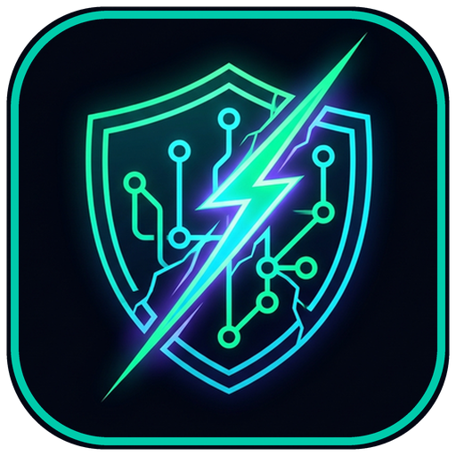

<div align="center">



# UnForce — ForcePush-Breaker (`v0.7.2`)

### **Cyber-Forensics Chromium Desktop Studio & CLI for Git History Exhumation, Branch Restoration & Secret Hunting**

*"Think `git push --force`, `git reset --hard`, or `git rm .env` erased your commits or leaked API keys? Think again."*

[](https://github.com/Amlaach/forcepush-breaker/actions/workflows/ci.yml)
[](https://github.com/Amlaach/forcepush-breaker/releases)
[](https://github.com/Amlaach/forcepush-breaker/actions/workflows/security.yml)
[](https://github.com/Amlaach/forcepush-breaker)
[](LICENSE)
[](https://sarifweb.azurewebsites.net/)
[](#bilingual-cyberpunk-hud-english--%D7%A2%D7%91%D7%A8%D7%99%D7%AA)

</div>

---

## Table of Contents

- [Overview](#overview)
- [Download & Instant Launch](#download--instant-launch)
- [Key Cyber-Forensics Capabilities](#key-cyber-forensics-capabilities)
  - [1. Multi-Platform Repository Target Support](#1-multi-platform-repository-target-support)
  - [2. Dangling Commit & Blob Exhumation Engine](#2-dangling-commit--blob-exhumation-engine)
  - [3. One-Click Local Branch Restoration & Cherry-Picking](#3-one-click-local-branch-restoration--cherry-picking)
  - [4. Remote GC Diagnostics (`GC_PURGED_REMOTE`)](#4-remote-gc-diagnostics-gc_purged_remote)
  - [5. Deleted `.env` & Sensitive Config Time Machine](#5-deleted-env--sensitive-config-time-machine)
  - [6. High-Entropy Secret Hunting & Passive Token Liveness](#6-high-entropy-secret-hunting--passive-token-liveness)
  - [7. Excision Recipes & Automated Purge Playbooks](#7-excision-recipes--automated-purge-playbooks)
  - [8. Multi-Format Audit Exports (SARIF 2.1.0, JSON, ZIP)](#8-multi-format-audit-exports-sarif-210-json-zip)
- [Chromium Desktop UI/UX Engineering](#chromium-desktop-uiux-engineering)
- [Bilingual Cyberpunk HUD (English / עברית)](#bilingual-cyberpunk-hud-english--עברית)
- [CLI Reference Guide](#cli-reference-guide)
- [CI/CD Integration (GitHub Actions)](#cicd-integration-github-actions)
- [Local Development & Building from Source](#local-development--building-from-source)
- [Security & Privacy Philosophy](#security--privacy-philosophy)
- [License](#license)

---

## Overview

In modern Git architecture, objects are immutable content-addressable blobs stored by cryptographic hash inside `.git/objects/`. When developers run:

```bash
git push --force origin main
# or
git reset --hard HEAD~1
# or
git rm .env && git commit --amend
```

**Git does not delete the commit or its contents.** It merely swings branch pointers. The underlying commits, trees, deleted configuration files, and plaintext credentials continue to reside inside the object database, reflogs (`HEAD@{...}`), and public fork networks.

**UnForce (ForcePush-Breaker)** is an enterprise cyber-forensics platform that systematically exhumes unreachable objects, restores deleted branches and commits with one click, detects leaked API keys with Shannon entropy analysis, verifies passive credential liveness, and generates verifiable excision playbooks.

---

## Download & Instant Launch

**No Python or Node.js runtime required.** End-user releases package the entire Chromium Electron frontend and the standalone compiled `unforce-engine` forensics daemon into a single self-contained application (only Git is needed on the host system):

| Operating System | Package | Description |
| :--- | :--- | :--- |
| **Windows (x64)** | [**UnForce-Setup-0.7.2.exe**](https://github.com/Amlaach/forcepush-breaker/releases/latest) | Full desktop installer with Start Menu & Desktop shortcuts |
| **Windows Portable** | [**UnForce-Portable-0.7.2.exe**](https://github.com/Amlaach/forcepush-breaker/releases/latest) | Zero-install portable executable for incident response USB drives |
| **macOS (Intel & Apple Silicon)** | [**UnForce-macOS-0.7.2-x64.dmg**](https://github.com/Amlaach/forcepush-breaker/releases/latest) | Native macOS `.dmg` and `.zip` distribution |
| **Linux (x64)** | [**UnForce-Linux-0.7.2-x64.AppImage**](https://github.com/Amlaach/forcepush-breaker/releases/latest) | Universal `.AppImage` and Debian/Ubuntu `.deb` packages |

> Every release package is cryptographically verified with accompanying `SHA256SUMS.txt` digests published in the [Releases](https://github.com/Amlaach/forcepush-breaker/releases) section.

---

## Key Cyber-Forensics Capabilities

### 1. Multi-Platform Repository Target Support
UnForce works seamlessly across both local disk repositories and major cloud Git hosts:
- **Local Developer Clones**: Drag-and-drop any repository folder directly into the desktop window, browse via the native OS directory selector, or paste absolute/relative paths (`C:\Projects\app`, `~/dev/backend`, `.`).
- **Cloud Git Hosts**: Direct scanning of remote repositories across **GitHub**, **GitLab**, and **Bitbucket** via HTTPS or SSH URLs (`https://github.com/owner/repo`, `https://gitlab.com/group/project`, `git@bitbucket.org:org/repo.git`).
- **Zero-Storage Private Authentication**: Automatically queries the host's Git Credential Manager (`git credential fill`) for in-memory token authentication, ensuring credentials are never saved to disk or configuration files.

### 2. Dangling Commit & Blob Exhumation Engine
- Scans loose and packed Git object databases using low-level Git plumbing (`fsck --lost-found --unreachable`, `rev-list`, `cat-file`).
- Reconstructs orphan commit parentage, authors, commit timestamps, and commit messages.
- Discovers unreachable blobs disconnected from active trees.
- Provides interactive unified diffs and complete historical file-tree navigation at any ghost snapshot.

### 3. One-Click Local Branch Restoration & Cherry-Picking
When lost commits or branches are discovered:
- **Instant Branch Restoration**: Click **"Restore Branch"** (`שחזר ענף מקומי`) to recreate a deleted or overwritten branch locally as `unforce/recovered-<sha7>` without destructive command line operations.
- **Direct Cherry-Picking**: Click **"Cherry-Pick"** (`החל קומיט`) to automatically cherry-pick a recovered ghost commit onto the active working branch.

### 4. Remote GC Diagnostics (`GC_PURGED_REMOTE`)
When scanning remote repositories where the remote host has aggressively executed server-side physical garbage collection (`git gc --prune=now`):
- UnForce automatically identifies the pruned state and flags a dedicated diagnostic alert: **`GC_PURGED_REMOTE`**.
- Explains the architectural limitation (remote server dropped unreachable object packs).
- Automatically prompts and provides a one-click trigger to scan the **local developer clone**, where reflogs, loose objects, and uncollected packs usually still survive intact!

### 5. Deleted `.env` & Sensitive Config Time Machine
- Dedicated heuristic filter for sensitive configuration files deleted via `git rm` or overwritten during forced pushes:
  - `.env`, `.env.production`, `.env.local`, `.env.staging`
  - Private Keys (`.pem`, `.key`, `id_rsa`, `id_ed25519`)
  - Cloud credentials (`credentials.json`, `service-account.json`, `client_secret*.json`)
  - Infrastructure state (`terraform.tfstate`, `kubeconfig`)
- Exhumes full file bodies directly from unreachable Git blobs with single-click download.

### 6. High-Entropy Secret Hunting & Passive Token Liveness
- Detects 18+ high-entropy credential families using a hybrid Shannon entropy and regex signature engine:
  - OpenAI / Anthropic / Gemini API keys
  - AWS Access Keys & Secret Keys (`AKIA...`)
  - GitHub Personal Access Tokens (classic `ghp_...` and fine-grained `github_pat_...`)
  - GitLab & Bitbucket Personal Access Tokens
  - Stripe Live & Test secret keys (`sk_live_...`)
  - Slack Bot & User tokens (`xoxb-...`, `xoxp-...`)
  - Google Cloud API keys & OAuth client secrets
  - Database connection URIs (PostgreSQL, MySQL, MongoDB, Redis)
  - Asymmetric Private Keys (`BEGIN RSA/OPENSSH PRIVATE KEY`)
- **Strict Masking by Default**: Raw tokens are cryptographically redacted (`sk-proj-****...`) across all UI tables, terminal outputs, and reports.
- **Passive Liveness Verification**: Non-destructive, read-only token status validation against vendor APIs (returns `ACTIVE`, `REVOKED`, or `UNVERIFIED` without executing state-altering actions).

### 7. Excision Recipes & Automated Purge Playbooks
Purging leaked secrets from Git requires comprehensive remediation:
- Generates tailored, copy-pasteable `git filter-repo --mirror --invert-paths` scripts.
- Supplies aggressive physical garbage collection sequences (`git reflog expire --expire=now --all && git gc --prune=now --aggressive`).
- Generates pre-formatted cache-purge support ticket templates for GitHub, GitLab, and Bitbucket support teams to purge server-side cached commit views.

### 8. Multi-Format Audit Exports (SARIF 2.1.0, JSON, ZIP)
- **SARIF 2.1.0**: Standardized Static Analysis Results Interchange Format for direct ingestion into GitHub Advanced Security Code Scanning.
- **Machine-Readable JSON**: Full forensic scan manifest for SIEMs, SOARs, and automation pipelines.
- **Human-Readable Markdown**: Executive audit reports ready for management and compliance reviews.
- **Forensic Recovery ZIP Bundle**: Downloadable archive containing recovered file trees, patches, and structured findings.

---

## Chromium Desktop UI/UX Engineering

UnForce Studio is engineered to meet the highest desktop usability standards:

- **Zero Console Flashes (`CREATE_NO_WINDOW`)**: All background Git processes, credential helpers, and daemon tasks on Windows are spawned with `windowsHide: true` and `CREATE_NO_WINDOW` flags. No annoying black command-prompt windows flash on the screen.
- **Sub-Second Cold Start (< 250ms)**: The pre-rendered Chromium UI bundle loads instantly from local application assets while the standalone Python engine daemon initializes asynchronously in parallel over local loopback IPC.
- **In-App Updater with TLS/SSL Fallback**: Built-in release check against GitHub Releases API with automatic fallback mechanisms for corporate proxies and SSL inspection firewalls.
- **Forensic Logs Drawer**: Collapsible telemetry drawer displaying real-time engine stdout/stderr, API request timings, and scan milestones.

---

## Bilingual Cyberpunk HUD (English / עברית)

UnForce includes native, high-fidelity internationalization designed specifically for Israeli and international cyber teams:

- **1-Click Language Switcher**: Instantly switch between **עברית (RTL)** and **English (LTR)**.
- **RTL-Compliant Layout**: Full right-to-left layout alignment for Hebrew text, descriptions, explanations, and action buttons.
- **Strict LTR Monospace Preserved**: Git SHA hashes, commit trees, code diffs, file paths, and terminal telemetry always remain strictly Left-to-Right monospace to prevent visual distortion.

---

## CLI Reference Guide

In addition to the Chromium Desktop Studio, UnForce provides a full-featured terminal CLI (available via either `unforce` or `gitghost`):

```bash
# Basic repository scan (local directory or remote URL)
unforce scan .
unforce scan https://github.com/owner/repository

# Scan without AI triage (fast deterministic heuristics only)
unforce scan . --no-ai

# Scan and export audit report to SARIF 2.1.0 (for GitHub Security)
unforce scan . --format sarif --output audit-results.sarif

# Scan and export full Recovery ZIP bundle with unredacted recovered files
unforce scan . --recover-zip recovered_evidence.zip --raw

# Filter and display only deleted configuration files (.env, keys)
unforce scan . --configs-only

# CI/CD Strict Quality Gate: exit with code 1 if critical secrets or score < 70
unforce scan . --strict --no-ai

# Launch Chromium Desktop Studio
unforce ui
```

---

## CI/CD Integration (GitHub Actions)

Integrate UnForce directly into your continuous integration workflow to block pull requests containing dangling secrets or upload SARIF reports to GitHub Security:

```yaml
name: UnForce Commit Forensics Gate

on:
  push:
    branches: [ "main" ]
  pull_request:
    branches: [ "main" ]

jobs:
  forensics-scan:
    name: UnForce Forensics & Secret Scan
    runs-on: ubuntu-latest
    steps:
      - name: Checkout Full Repository History
        uses: actions/checkout@v4
        with:
          fetch-depth: 0

      - name: Set up Python 3.12
        uses: actions/setup-python@v5
        with:
          python-version: "3.12"
          cache: "pip"

      - name: Install UnForce
        run: |
          pip install --upgrade pip
          pip install gitghost

      - name: Execute Security Forensics Scan
        run: |
          unforce scan . --no-ai --format sarif --output results.sarif --strict

      - name: Upload Results to GitHub Code Scanning
        uses: github/codeql-action/upload-sarif@v3
        if: always()
        with:
          sarif_file: results.sarif
          category: unforce-forensics
```

---

## Local Development & Building from Source

### Prerequisites
- Python 3.9+ (Python 3.12 recommended)
- Node.js 20+ (Node.js 22 recommended)
- Git 2.30+

### Setup & Testing
```bash
# Clone the repository
git clone https://github.com/Amlaach/forcepush-breaker.git
cd forcepush-breaker

# Install Python package in editable mode with development dependencies
pip install -e ".[all]"

# Run full Pytest test suite (99 comprehensive tests)
pytest -v tests/
```

### Building Desktop Packages Locally

**On Windows (PowerShell):**
```powershell
powershell -ExecutionPolicy Bypass -File scripts/build_desktop.ps1
```
*Generates NSIS installer (`UnForce-Setup-0.7.2.exe`) and portable binary (`UnForce-Portable-0.7.2.exe`) in `release/`.*

**On macOS / Linux (Bash):**
```bash
bash scripts/build_desktop.sh
```
*Generates `.dmg` / `.zip` on macOS and `.AppImage` / `.deb` on Linux in `release/`.*

---

## Security & Privacy Philosophy

1. **Local Execution**: All repository parsing, Git plumbing commands, entropy calculations, and regex evaluations execute locally on your machine.
2. **In-Memory Credential Safety**: When authenticating with remote private repositories, tokens are held transiently in memory for the duration of the scan process and are never committed to disk.
3. **Strict Redaction by Default**: All sensitive credentials are cryptographically redacted in console displays, user interfaces, and exported reports unless `--raw` / unredacted export is explicitly requested by authorized forensic analysts.

---

## License

This project is licensed under the **MIT License**. See the [LICENSE](LICENSE) file for details.
